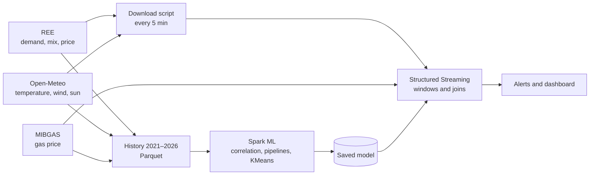

# Plan · What explains electricity demand, generation mix and price in Spain

Big Data, UMA Master's · 3 November 2026

## Description

We analyze the Spanish electricity system with Red Eléctrica's (REE) open data: demand every 5 minutes, generation by technology (wind, solar, nuclear, hydro, combined-cycle gas…) and the market price. We combine it with two sources that can explain it: weather (temperature, wind and solar radiation, from Open-Meteo) and the natural gas price on the Iberian market (MIBGAS).

The **ML** part explains and predicts using the 2021–2026 history. The **streaming** part follows the system in real time and applies the trained models.

## Motivation

- REE publishes history and real time in the same format and without registration, so the same code serves for training and for streaming.
- There is a physical explanation behind the data that can be tested: cold and heat drive demand, wind and sun drive renewables, and when renewables fall short gas fills the gap and usually sets the price.
- It lets us use every piece of the course on the same data: correlation, visualization, Spark ML pipelines and Structured Streaming.

## Data sources

| Source | What it provides | History | Real time |
|---|---|---|---|
| REE · REData API (`apidatos.ree.es`) | Actual, forecast and scheduled demand; market price and PVPC | Yes | Yes |
| REE · demand and generation (`demanda.ree.es`) | Peninsular demand and generation by technology every 5 minutes; REE's peninsular demand forecast | Yes | Yes |
| Open-Meteo | Temperature, wind at 100 m and solar radiation | Hourly archive | Current data every 15 minutes |
| MIBGAS | Daily natural gas price on the Iberian market | Yearly files | Daily |
| Working calendar | National holidays | Yes | — |

## Questions

1. **Demand.** How much of demand does temperature explain? We expect a U-shaped curve: demand rises on the coldest days (heating) and on the hottest ones (cooling).
2. **Generation mix.** How much of renewable generation do wind and sun explain, and which technology fills the gap when they fall short?
3. **Price.** How much of the electricity price do the gas price and the renewable share explain?

## Granularity

- The modeling unit is the **hour**. It is the finest scale at which all sources line up (historical weather is hourly) and it gives many more rows than the day.
- Every source is aggregated per hour with means, because demand and generation are power values (MW). This covers REE's 5-minute readings and, since 2025, the quarter-hour prices. Gas, which is daily, is repeated across the 24 hours of the day.
- All timestamps are in UTC, so that daylight-saving days (23 or 25 hours) neither duplicate nor lose hours when sources are joined.
- The day is used for correlation and visualization (demand against temperature on the coldest and hottest days) and for clustering the 24-hour curve of each day.

## ML part (Spark ML)

- Ingestion and cleaning in Spark, with data stored as Parquet partitioned by month.
- Correlation analysis (`pyspark.ml.stat.Correlation`) and visualizations built from aggregates computed in Spark.
- Spark ML pipelines (`VectorAssembler`, `OneHotEncoder`, `StandardScaler`, model), tuned with `ParamGridBuilder` on a temporal validation set:
  - Hourly demand regression from temperature, hour, day of week, month and holidays. A linear regression, whose coefficients can be read, is compared with Random Forest and GBT. The target is the peninsular demand of the 5-minute feed, and the baseline to beat is REE's own peninsular forecast. The 28 April 2025 blackout is excluded from training and validation.
  - Hourly price regression from the gas price, the renewable share, demand and hour.
  - KMeans on the 24-hour curve of each day to find day types: cold winter day, hot summer day, windy day, sunny day.
- Temporal validation: train on 2021–2024, validate on 2025 and test on 2026.

## Streaming part (Structured Streaming)

- A script downloads REE's and Open-Meteo's real-time data every 5 minutes into a folder, which Spark reads as a file source (the same pattern as in lab 1).
- Spark follows the system every 5 minutes: the renewable share and the deviation between actual demand and REE's forecast.
- At the same time it aggregates the readings into 1-hour windows and compares them with the demand the hourly model expects for that hour, computed from the current temperature and the calendar. The stream is joined with the latest gas price.
- Alerts are raised for a demand peak, an hour that departs from what was expected, or a large gas share in the mix.
- **Replay mode:** the history is replayed as if it were a stream, to validate the results and to demo without depending on the network.

## Architecture

## Planned extensions

- Integration of several sources: REE, Open-Meteo, MIBGAS and calendar.
- Kafka for real-time ingestion (iteration 3, if time allows).
- Documented AI-assisted development: `AGENTS.md`, a Python guide with unit and integration tests, and GitHub Actions.

## Schedule

| Iteration | Dates | ML | Streaming |
|---|---|---|---|
| 1 | 3–10 Nov | Download the history to Parquet; first correlations and charts | Download script and first streaming read with windows; repository and `AGENTS.md` |
| 2 | 10–17 Nov | Features (temperature, calendar, renewable share); demand and price pipelines; KMeans | Join with temperature and gas; apply a first model |
| 3 | 17–24 Nov | Validation and test on 2026; interpretation of results | Alerts, replay mode and Kafka; tests and continuous integration |
| Final | 24 Nov–1 Dec | Integration, demo and presentation | Integration, demo and presentation |

## Risks

- REE's real time can stall: on 3 November actual demand stopped updating mid-morning. That is why replay mode is included.
- Spain has no single temperature: several representative cities must be chosen and weighted.
- The market price moved from hourly to quarter-hourly in 2025: from then on it is aggregated per hour as the mean of the four quarters.
- Gas has a daily price: the hourly model sees the same value across the 24 hours, so its effect shows in the level of the day, not in the shape of the curve.
- The "Iberian exception" (2022–2023) capped the price of gas used to generate electricity. It must be treated as a regime change in the price model.
- The Iberian blackout of 28 April 2025 left a day with a mean demand of 15,512 MW, far below any other working day. It is excluded from training and validation and flagged as an anomaly.
- REE publishes demand for two systems: the 5-minute feed is peninsular and REData's series is national, about 5% higher. The model and its baseline both use the peninsular series.

## Links

- REE, REData API: <https://apidatos.ree.es/es/datos/demanda/demanda-tiempo-real>
- REE, demand and generation: <https://demanda.ree.es/WSvisionaMovilesPeninsulaRest/resources/demandaGeneracionPeninsula>
- Open-Meteo, historical archive: <https://archive-api.open-meteo.com/v1/archive>
- Open-Meteo, current data: <https://api.open-meteo.com/v1/forecast>
- MIBGAS, file downloads: <https://www.mibgas.es/es/file-access>
